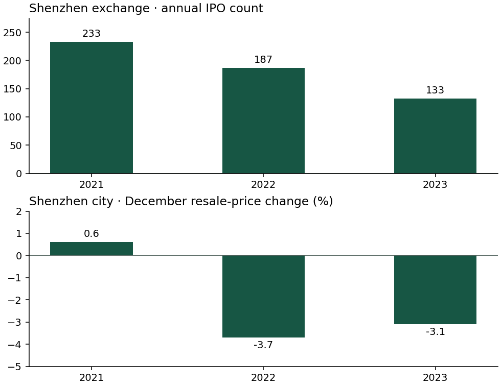

<link rel="stylesheet" href="../assets/essentials-figures.css">
<script src="../assets/essentials-figures.js" defer></script>

::: {.decision}
**Your task.** An analyst puts “Shenzhen IPOs” and “Shenzhen house prices” on one line chart. Before you show it to a client, identify the population, unit, and observation window for each series.
:::

Use the [fixed 2021–23 CSV](../assets/shenzhen-2021-2023.csv). The IPO count is a flow of offerings on the Shenzhen exchange over each calendar year. The housing measure is the December price index for second-hand residential buildings in Shenzhen city, relative to the previous December. An index of 96.3 means prices fell 3.7%. It gives neither the price of a flat nor the number sold.

## Reproduce the exhibit

Open the CSV in a spreadsheet. Put year on the horizontal axis. Plot column B as annual IPO counts. In D2 enter `=C2-100`, fill down, and plot D as percentage points on a separate chart with a visible zero line. Use numeric labels such as −3.7% for the resulting change. If applying a spreadsheet percentage format, use `=C2/100-1` instead. Both panels should use identical years.




```{=html}
<figure class="ess-figure" data-essentials-figure="measurement-workshop">
<figcaption><strong>Read annual change and price level side by side</strong></figcaption>
<p>The first panel reports year-on-year December growth. The second sets December 2021 equal to 100 and compounds the 2022 and 2023 growth rates. Both panels use the fixed classroom data. Keep the IPO count in its own panel because it measures an annual flow of offerings on the exchange.</p>
<div class="ess-chart"></div>
<p><strong>Read the graph.</strong> Would you approve “Shenzhen resale prices recovered in 2023” as a chart caption?</p>
<details><summary>Check your reading</summary><p>The decline slowed from 3.7% to 3.1%, but the price level fell again to about 93.31 on the December 2021 base. A defensible caption says that Shenzhen city second-hand residential prices continued to fall year on year in December 2023, at a slower rate than in December 2022. The IPO series measures offerings on the Shenzhen exchange over the calendar year.</p></details>
</figure>
```

<details><summary>Audit a misleading headline</summary><p>“Shenzhen house prices recovered in 2023” confuses growth with level. The annual change improved from −3.7% to −3.1%, a 0.6 percentage-point improvement. The price level still fell. Starting from December 2021 = 100, the December 2023 level is 100 × 0.963 × 0.969 ≈ 93.31. IPO counts dropped by 54 between 2022 and 2023, about 28.9%.</p></details>

**Source trail.** The CSV transcribes the Shenzhen row, second-hand housing table, prior-year-month column from each NBS release, and the Shenzhen exchange counts from the PwC comparison. It fixes the release vintages for classroom replication. [NBS December 2021](https://www.stats.gov.cn/english/PressRelease/202201/t20220117_1826410.html) · [December 2022](https://www.stats.gov.cn/english/PressRelease/202301/t20230116_1891673.html) · [December 2023](https://www.stats.gov.cn/english/PressRelease/202401/t20240117_1946674.html) · [PwC China IPO Watch 2023, Greater China exchange comparison](https://www.pwccn.com/en/ipo/china-ipo-watch-2023.pdf)

[Continue to causal evidence](causal-evidence.html?route=full-course)

```{=html}
<section aria-label="Practice brief"><h2>What caption would you approve under the two panels?</h2><details><summary>Compare your recommendation</summary><p>Exchange-wide IPO counts fell from 187 to 133 in 2023. Shenzhen city resale prices fell 3.1% year on year that December, after a 3.7% fall a year earlier. The smaller decline describes the rate of change while the price level continued to fall.</p></details></section>
```

